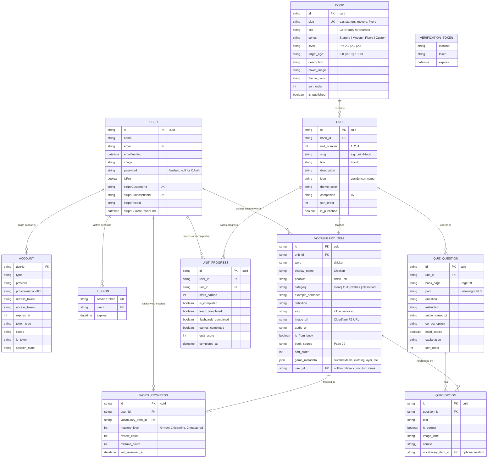
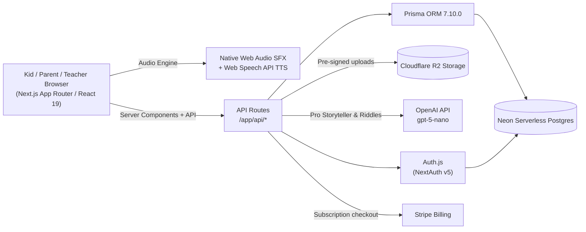

# FunEnglish — Project Overview

> An interactive, gamified English learning hub for kids ages 3–13 powered by the *Get Ready for Starters, Movers, and Flyers* curriculum — featuring playful character companions, Cambridge YLE quizzes, interactive flashcards, phonics, and AI storytelling.

**Status:** In Development / MVP (Starters Unit 4: Food complete) · **Last updated:** 2026-10-21

## Table of Contents

1. [Problem & Vision](#1-problem--vision)
2. [Target Users & Cambridge Pathway](#2-target-users--cambridge-pathway)
3. [Features & Curriculum](#3-features--curriculum)
4. [Data Model](#4-data-model)
5. [Tech Stack](#5-tech-stack)
6. [System Architecture](#6-system-architecture)
7. [Monetization](#7-monetization)
8. [UI / UX](#8-ui--ux)
9. [Open Questions](#9-open-questions--not-yet-decided)
10. [Engineering Guardrails](#10-engineering-guardrails)

---

## 1. Problem & Vision

Children learning English as a second or foreign language face significant friction with existing digital tools:

- **Boring rote drill apps**: Traditional flashcard apps feel like digital homework without storyline, emotional connection, or playful motivation.
- **Fragmented learning experiences**: Phonics in one app, vocabulary memorization in another, grammar drills in a third, and real conversational listening nowhere.
- **Disjointed progression**: Toddler apps are too basic for 9–13 year-olds, while test-prep books lack the tactile interactivity needed to keep 3–7 year-olds engaged.
- **Distracting & ad-heavy environments**: Free kids apps are often filled with inappropriate ads and manipulative microtransactions that disrupt focus.
- **Lack of cohesive curriculum grounding**: Most apps teach random, isolated words instead of following a recognized, structured international curriculum.

### The Vision: From Food Prototype to the Complete YLE Journey

The current app started with a high-fidelity proof-of-concept around **Unit 4: "Food!"** from the Cambridge / Oxford ***Get Ready for Starters*** book (featuring *Lily's Yummy English Adventure*). 

**FunEnglish** is expanding this proven, gamified formula across:
1. **All Units of *Get Ready for Starters*** (Pre-A1: Hello, School, Toys, Food, Animals, Clothes, Body, Family, Town, etc.).
2. ***Get Ready for Movers*** (A1: expanding grammar, past tense, descriptive listening, story narration).
3. ***Get Ready for Flyers*** (A2: complex dialogue comprehension, sentence building, reading fluency for junior learners up to age 13).

By pairing every unit with interactive character games (feeding, sorting, dressing, exploring), authentic listening exam questions, tactile spelling tiles, and generative AI companions, FunEnglish turns the standard book series into an immersive, living learning adventure.

---

## 2. Target Users & Cambridge Pathway

The application spans three official Cambridge Young Learners English (YLE) stages across ages 3–13:

| Cambridge Level | Book Series | Target Age | Core Learning Focus & Mechanics |
|---|---|---|---|
| **Pre-A1 Starters** | ***Get Ready for Starters*** | Ages 3–7/8 | Phonics sounds, foundational vocabulary (Food, Toys, Animals, Body), listening recognition, tactile tap-and-feed games with character companion Lily, simple word anagrams. *(Unit 4 Food is current live MVP)* |
| **A1 Movers** | ***Get Ready for Movers*** | Ages 8–10 | Expanded vocabulary (Health, Weather, Transport, Hobbies), sentence patterns, prepositions of place, comparative adjectives, multiple-speaker listening dialogues, interactive story-sorting games. |
| **A2 Flyers** | ***Get Ready for Flyers*** | Ages 10–13 | Fluent reading comprehension, complex grammatical structures, context-driven AI riddles, timed challenges, vocabulary synthesis, and conversational practice. |
| **Parents & Teachers** | Management & Tools | Adults | Multi-child progress tracking, curriculum unit completion badges, printable official-style certificates, and custom flashcard creator tools with Cloudflare R2 uploads. |

---

## 3. Features & Curriculum

### 3.1 Curriculum Structure: Book Series & Unit Hierarchy

The learning journey is organized hierarchically:
`Series (Starters / Movers / Flyers) ➔ Unit (e.g. Unit 4: Food) ➔ Activities (Game, Quiz, Flashcards, Spelling, Story)`

```
┌────────────────────────────────────────────────────────────────────────┐
│                        FunEnglish Curriculum                           │
└────────────────────────────────────┬───────────────────────────────────┘
                                     │
    ┌────────────────────────────────┼────────────────────────────────┐
    ▼                                ▼                                ▼
Pre-A1 Starters (Ages 3-8)      A1 Movers (Ages 8-10)          A2 Flyers (Ages 10-13)
*Get Ready for Starters*        *Get Ready for Movers*         *Get Ready for Flyers*
├── Unit 1: Hello & Classroom   ├── Unit 1: Our School         ├── Unit 1: Around the Town
├── Unit 2: My Family           ├── Unit 2: At the Weekend     ├── Unit 2: Space & Science
├── Unit 3: Playtime & Toys     ├── Unit 3: Daily Routine      ├── Unit 3: Famous People
├── Unit 4: Food! (★ Live MVP)  ├── Unit 4: Weather & Seasons  ├── Unit 4: Nature & Wildlife
├── Unit 5: Animals & Pets      └── ... (Units 5-12)           └── ... (Units 5-12)
├── Unit 6: Clothes & Dressing
└── ... (Units 7-12)
```

Each unit features 5 core integrated activities tailored to that unit's theme and vocabulary:

| Activity Type | Kind | Icon (lucide-react) | Color | Unit Example (Food vs. Clothes vs. Animals) |
|---|---|---|---|---|
| `game` | Interactive Play | `Gamepad2` | `#ec4899` (pink) | **Food**: Feed Lily meals · **Clothes**: Dress Lily for weather · **Animals**: Pet rescue park |
| `quiz` | Exam Listening | `HelpCircle` | `#8b5cf6` (purple) | Authentic Cambridge Practice Test questions (listening dialogs, bag packing, crosswords) |
| `flashcard` | Audio/Visual Phonics | `Layers` | `#3b82f6` (blue) | Interactive talking cards with syllable breakdown (`wa · ter · mel · on`) & Web Audio TTS |
| `spelling` | Anagram Puzzle | `Puzzle` | `#f97316` (orange) | Chunky letter tiles with pop audio feedback, unscrambling Cambridge vocabulary |
| `story` *(Pro)* | Generative AI | `Sparkles` | `#eab308` (yellow) | 3-sentence Cambridge Starters/Movers/Flyers stories & phonics riddles via `gpt-5-nano` |
| `custom` *(Pro)* | User Created | `PlusCircle` | `#10b981` (emerald) | Parents/teachers add custom words with Cloudflare R2 image upload and voice synthesis |

Route convention: `/series/[seriesId]/unit/[unitId]/[activity]` (e.g. `/series/starters/unit/4/feed`, `/series/movers/unit/1/quiz`).

### 3.2 The Proof-of-Concept: Unit 4 "Food!" (Live MVP)

The current working prototype proves the educational loop using Cambridge Starters Unit 4 ("4 Food!"):
- **Feed Lily Game**: Breakfast, Lunch, Dinner, and Dessert plates; character responds with chomping animations, mouth movement, heart particles, and voice speech lines.
- **Starters Practice Test Quiz**:
  - *Page 29 Part 3*: Pat's favourite food (Chicken vs. Sausages vs. Burgers).
  - *Page 29 Part 3*: Dan's breakfast (Eggs & Bread).
  - *Page 26 Part 1*: Sam's lunch & favourite dinner (Fish, rice, pineapple; burger & chips).
  - *Page 24 Unit 4*: Lime citrus fruit riddle ("They're limes!").
  - *Page 28 Part 3*: Pineapple anagram puzzle (P-I-N-E-A-P-P-L-E).
  - *Page 37 Revision 1*: Sue's flower bag fruit packing (Banana, grapes, orange).
  - *Page 25 Unit 4*: Crossword puzzles (1-Down: P-I-E).
- **Spelling Letter Tiles**: 24+ Cambridge food words (Meatballs, Kiwis, Sausages, Coconut, Lemon, Lime, Mango, etc.).
- **Talking Food Dictionary**: 34+ words with syllable breaks and live Web Speech synthesis.

### 3.3 Next Units in the Pipeline

With the architecture proven in Unit 4, upcoming units follow the identical modular component pattern:
- **Unit 6: "Clothes" (*Get Ready for Starters*)**: Interactive dress-up game (Lily's wardrobe: shirts, dresses, hats, shoes, socks), Cambridge colour & clothing quizzes, clothing spelling tiles.
- **Unit 5: "Animals" (*Get Ready for Starters*)**: Habitat matching game, animal sound listening quizzes, syllable breakdowns for multi-syllable creatures (crocodile, elephant).
- **Unit 1: "In the Classroom" (*Get Ready for Starters*)**: Backpack packing interactive game, school supplies quizzes, prepositions of place.

### 3.4 Authentication & Multi-Profile Support

- Parent/Teacher authentication via **Auth.js (NextAuth v5)**:
  - Email/password credentials
  - GitHub OAuth (with Google OAuth planned)
  - Frictionless guest onboarding with local offline fallback.
- Child profile isolation: stars, completed units, and level progression tracked independently.

### 3.5 AI Features (Pro only)

- **AI Cambridge Storyteller**: Generates 3-sentence stories adapted to the target Cambridge level (Pre-A1 Starters, A1 Movers, or A2 Flyers) using OpenAI `gpt-5-nano` or on-device Chrome Built-in AI (Gemini Nano).
- **AI Phonics & Grammar Riddles**: Generates rhyming clues for Starters or grammar challenge riddles for Movers/Flyers.
- **AI Pronunciation Coach** *(Roadmap)*: Real-time speech evaluation comparing child voice input with phoneme pronunciation.

### 3.6 Other Core Features

- **Star Reward Economy**: Stars earned across all unit games and quizzes, stored in Neon Postgres.
- **Printable Unit & Series Certificates**: Milestone certificates awarded upon completing all units in a series (e.g. *Cambridge Starters Master Award*).
- **Procedural Zero-Latency Audio**: Native Web Audio synthesizer for instant tactile sound effects (pops, chomps, fanfare) without audio asset CDN latency.
- **Custom Flashcard Creator**: Parents and teachers can upload photos to **Cloudflare R2**, add phonics hints, and persist new words to Postgres.

---

## 4. Data Model

### 4.1 Entity Relationship Diagram

The schema generalizes the MVP `FoodItem` structure into a complete multi-series, multi-unit Cambridge learning hub, managed via Prisma 7 and hosted on Neon Serverless PostgreSQL:



### 4.2 Prisma Schema & Architectural Decisions

**[`prisma/schema.prisma`](../../prisma/schema.prisma) is the source of truth.** 

#### Multi-Unit Curriculum & Unified Database Standard
- **Curriculum & Auth Models**: The schema implements `User`, `Account`, `Session`, `VerificationToken`, `Book`, `Unit`, `VocabularyItem`, `QuizQuestion`, `QuizOption`, `UnitProgress`, and `WordProgress`.
- **Strict snake_case Convention**: All tables map to PostgreSQL plural `snake_case` using `@@map` (`users`, `accounts`, `sessions`, `verification_tokens`, `books`, `units`, `vocabulary_items`, `quiz_questions`, `quiz_options`, `unit_progress`, `word_progress`), and all multi-word fields use `@map` on columns (`created_at`, `email_verified`, `unit_id`, etc.).
- **Legacy Models Removed**: The initial proof-of-concept `FoodItem` and `UserProgress` tables have been dropped; food curriculum items now live directly in `vocabulary_items` with unit relations and `game_metadata`, and progress is tracked via `unit_progress`.

#### Database Design Decisions
- **CUID Primary Keys**: All models use web-friendly string IDs (`@default(cuid())`), matching Auth.js v5 defaults.
- **Indexes & Unique Constraints**:
  - `Unit`: `@@unique([bookId, slug])`, `@@index([bookId, sortOrder])`
  - `VocabularyItem`: `@@index([unitId, sortOrder])`
  - `QuizQuestion`: `@@index([unitId, sortOrder])`
  - `UnitProgress`: `@@unique([userId, unitId])`
  - `WordProgress`: `@@unique([userId, vocabularyItemId])`, `@@index([userId, masteryLevel])`
  - NextAuth: `Account @@id([provider, providerAccountId])`, `Session @unique([sessionToken])`, `VerificationToken @@id([identifier, token])`.
- **Cascade Deletes & Ownership**:
  - Deleting a `Book` cascades down to `Unit`, `VocabularyItem`, `QuizQuestion`, `QuizOption`, and `UnitProgress`.
  - Deleting a `User` cascades down to `Account`, `Session`, `UnitProgress`, `WordProgress`.
  - System curriculum items have `userId = null`. User-created items set `userId` with `onDelete: SetNull`.

#### Prisma 7 + Neon PostgreSQL Setup
- **Serverless PostgreSQL**: Hosted on Neon (`ep-*-pooler.c-8.eu-central-1.aws.neon.tech`).
- **Connection Strategy**:
  - `DATABASE_URL`: Connection-pooled URL (`-pooler` host) configured in runtime via `@prisma/adapter-neon` with `@neondatabase/serverless` for fast serverless queries over WebSockets/HTTP.
  - `DATABASE_URL_UNPOOLED`: Direct connection URL used in `prisma.config.ts` for running migrations (`prisma migrate dev` and `prisma migrate deploy`) to avoid connection pooler transaction/advisory lock limitations.
- **Branching Policy**: Development branch configured in `neon.ts` for feature iteration; production branch for deployed releases. Schema changes are strictly managed via migrations (never `db push`).
- **Prisma 7 Configuration**: Config in `prisma.config.ts`, generated client output at `src/generated/prisma`. Run `npm run prisma:generate` after any schema change.

---

## 5. Tech Stack

| Layer | Choice | Notes |
|---|---|---|
| **Framework** | [Next.js 16](https://nextjs.org/docs) / [React 19](https://react.dev) | App Router with React Server Components, Server Actions, and dynamic `/api/*` endpoints. Single unified repository. |
| **Language** | TypeScript (Strict) | End-to-end type safety across curriculum models, quiz options, and audio states. |
| **Database** | [Neon](https://neon.tech/docs) | Serverless PostgreSQL with autoscaling and connection pooling. |
| **ORM** | [Prisma 7](https://www.prisma.io/docs) (`7.10.0`) | Config in `prisma.config.ts`, client generated to `src/generated/prisma`, connects via `@prisma/adapter-neon`. |
| **File Storage** | [Cloudflare R2](https://developers.cloudflare.com/r2/) | S3-compatible object storage via `@aws-sdk/client-s3` for custom vocabulary flashcard uploads (`/api/upload`). |
| **Auth** | [Auth.js / NextAuth v5](https://authjs.dev) | Parent & Teacher credentials + GitHub OAuth (Google OAuth planned). |
| **AI** | [OpenAI API](https://platform.openai.com/docs) (`gpt-5-nano`) | Level-tailored 3-sentence Cambridge story generator and phonics/grammar riddles; supports Chrome Built-in AI fallback. |
| **Audio Engine** | Web Audio API + Web Speech API | Dual audio engine: native Web Audio for procedural zero-latency SFX (pops, chomps, fanfare) + Web Speech API for authentic English enunciation. |
| **Styling** | [Tailwind CSS v4](https://tailwindcss.com/docs) + [shadcn/ui](https://ui.shadcn.com) | Pure CSS-based theme (`@theme` in `globals.css`), pastel candy gradients, accessible Radix UI primitives. |
| **Payments** | [Stripe](https://stripe.com/docs) | Monthly ($4.99) and annual Pro subscriptions for families and classrooms. |

---

## 6. System Architecture



---

## 7. Monetization

Freemium model tailored for individual families, homeschoolers, and language centers:

| Feature | **Free Explorer** | **Pro Learner** — $4.99/mo or $49/yr |
|---|---|---|
| Complete Unit 4: Food (Live MVP) | ✅ Full access (Game, Quiz, Dictionary) | ✅ Full access |
| Additional *Get Ready for Starters* Units | 1 sample unit | ✅ All Starters Units (1–12) |
| *Get Ready for Movers* (A1) Series | ❌ | ✅ All Movers Units (1–12) |
| *Get Ready for Flyers* (A2) Series | ❌ | ✅ All Flyers Units (1–12) |
| Cambridge Exam Practice Quizzes | 3 questions per unit | Complete Question Bank for all units |
| Spelling Tiles & Crosswords | 5 words per unit | Complete vocabulary anagram sets |
| Custom Flashcards (Uploads) | Up to 3 cards | Unlimited with Cloudflare R2 hosting |
| AI Storyteller (`gpt-5-nano`) | ❌ | ✅ Unlimited stories across all levels |
| AI Phonics & Grammar Riddles | ❌ | ✅ Unlimited interactive riddles |
| Printable Cambridge Award Certificates | ❌ | ✅ Official-style PDF certificates for every unit & series |
| Child Profiles per Account | 1 child | Up to 5 children with independent progress |

> During active development, all users are granted Pro privileges (`isPro: true`) to ensure seamless testing of AI generation and image upload pipelines.

---

## 8. UI / UX

**General direction:** Playful, vibrant, and accessible for young learners. Light mode by default with warm pastel gradients, soft rounded corners (`rounded-2xl`, `rounded-3xl`), and candy-colored interactive badges.

### 8.1 Series & Unit Navigation (The Learning Adventure Map)

- **Level Roadmap**: Visual island/path map letting children select their series (*Get Ready for Starters*, *Movers*, or *Flyers*) and tap into book units (Unit 1: Classroom, Unit 4: Food, Unit 6: Clothes).
- **Companion-First Stage**: Character companion (Lily for Starters, joined by peer companions Leo and Max in Movers/Flyers) remains anchored alongside activities, offering encouraging voice praise, reactive animations, and outfit changes.
- **Tactile Touch Targets**: Minimum 48px hit area across all letter tiles, quiz options, and food items for comfortable tapping on iPads and touch displays.
- **Audio-First Instructions**: Text is paired with Web Speech narration so non-reading 3–5 year-olds can navigate without adult intervention.

### 8.2 Auditory Experience

- **Zero-Latency Sound Synthesis**: Procedural sound generation via the Web Audio API eliminates the 200–500ms network delay typical of audio asset CDNs.
- **Phonics Syllable Vocalization**: Words are broken into syllables (`pine · ap · ple`) to assist reading decoding alongside auditory playback.
- **British & American Accent Selection**: Automatically favors friendly system voices (`Google US English`, `Samantha`, `Victoria`) for natural, clear enunciation.

### 8.3 Responsive Breakpoints

- **Tablet/iPad Landscape**: 12-column grid with a dedicated 4-column character companion sidebar and an 8-column interactive activity stage.
- **Mobile Viewport**: Companion collapses into a top status bar or floating avatar; navigation buttons convert into an accessible horizontal scrolling bar.

---

## 9. Open Questions / Not Yet Decided

- **Schema Migration Timing**: Transitioning the database from `food_items` to `learning_items` with `unit_id` and `series_id` foreign keys while preserving existing seed data and UI compatibility.
- **Character Roster per Level**: Whether Lily remains the sole companion across all three series, or if older companions (e.g. Leo and Maya) should join for *Get Ready for Movers* and *Flyers* to better resonate with 9–13 year-olds.
- **Speech Recognition for Pronunciation**: Testing on-device Web Speech recognition against server-side OpenAI Whisper for grading child spoken pronunciation.
- **Offline / PWA Capability**: Implementing Service Worker caching and IndexedDB synchronization so children can play games in offline environments (e.g. car trips, flights).
- **School / Teacher Dashboard**: Grouping student profiles under a classroom code with aggregate unit mastery reports for language school teachers.

---

## 10. Engineering Guardrails

- **Prisma Migration Protocol**: **Never** execute `prisma db push` in production or manually edit the database schema. All changes must be made via `prisma migrate dev`, verified in development, and deployed with `prisma migrate deploy`.
- **Prisma 7 Client Generation**: `prisma migrate dev` does **not** automatically regenerate the client in Prisma 7. Always run `npm run prisma:generate` following any schema update to avoid `TableDoesNotExist` runtime exceptions.
- **Tailwind CSS v4 Configuration**: We use Tailwind CSS v4's CSS-first architecture. **Do not create** `tailwind.config.ts` or `tailwind.config.js`. All design tokens, custom colors, and animations belong in `src/app/globals.css` using the `@theme` directive.
- **Audio Context Gestures**: The Web Audio `AudioContext` and Web Speech APIs require an initial user interaction. Ensure all sound triggers are tied to user gestures (button clicks, card selections) to avoid browser autoplay blocks.
- **Child Privacy & Safety**: Strictly no third-party tracking scripts, invasive telemetry, or advertising SDKs. Data stored is limited to parent contact information and child learning game progress.
- **TypeScript Strictness**: No `any` types permitted; all API requests, responses, and game states must be strictly typed or validated with Zod schemas.
- **Preserve Unit 4 Compatibility**: All future unit additions must follow the proven component contract established in Unit 4 (`QuizGame`, `FeedGame` / thematic unit game, `DictionaryView`, `CharacterLily`), keeping the codebase modular and regression-free.
