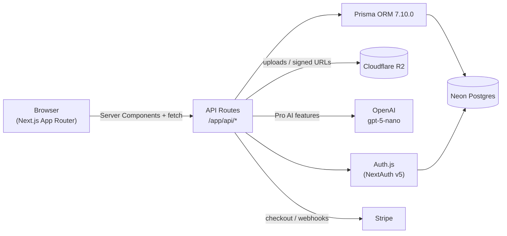

# 🍓 Lily's Yummy English Adventure! 
### Next.js 16 + React 19 Interactive English Learning Web App
*Based on Cambridge Young Learners English (Starters Practice Tests & Unit 4: "4 Food!")*

---

## 🌟 Overview

**Lily's Yummy English Adventure** is a modern, full-stack educational web application designed for young children learning English food vocabulary, built with **Next.js 16 (App Router)** and **React 19**.

It brings the questions, dialogues, crossword puzzles, and illustrations from the Cambridge Starters Practice Test book and **Unit 4: "4 Food!"** to life with **Lily**, an animated little girl wearing a customizable pink or purple dress. Children learn meal names, spelling, phonics, and listening comprehension while enjoying procedural zero-latency sound effects and spoken English narration.

---

## 🛠️ Modern Tech Stack

| Layer | Choice | Notes |
|---|---|---|
| **Framework** | **Next.js 16** / **React 19** | App Router, SSR pages with dynamic client components, `/api/*` routes |
| **Language** | **TypeScript** | Strict, end-to-end type safety |
| **Database** | **Neon** | Serverless Postgres |
| **ORM** | **Prisma 7** (`7.10.0`) | Config in `prisma.config.ts`, client generated to `src/generated/prisma`, connects via `@prisma/adapter-neon` |
| **File Storage** | **Cloudflare R2** | S3-compatible pre-signed upload URLs for vocabulary images (`/api/upload`) |
| **Auth** | **Auth.js / NextAuth v5** | Parent / Teacher accounts (Credentials + GitHub OAuth) |
| **AI** | **OpenAI API** (`gpt-5-nano`) | Pro-only Starters Storyteller and interactive Phonics Riddles |
| **Styling** | **Tailwind CSS v4** + **shadcn/ui** | Light mode, cheerful pastel gradients, responsive layouts, child-friendly candy accents |
| **Payments** | **Stripe** | Pro subscriptions (`isPro`, customer & subscription tracking on `User`) |

---

## 📐 System Architecture



---

## 🎮 Features & Activities

### 1. 🍽️ Feed Lily (Meals & Desserts)
- **Breakfast ☀️**: Eggs, sausages, tomatoes, beans, bread, banana, orange (Dan's breakfast on Page 29 & Page 26).
- **Lunch 🥪**: Roast chicken, fresh salad, bread, burgers, fish, rice, pineapple, grapes, pears, meat (Sam's lunch on Page 26).
- **Dinner 🌙**: Sausages, chicken, burger, chips, pie, meatballs, potatoes, carrots, peas, beans, salad (Pat's favourite food on Page 29 & Sam's dinner on Page 26).
- **Sweet Dessert 🍨**: Watermelon, mango, kiwi, coconut, pineapple, ice cream, cake, cookies, jelly, pie.
- **Interactive Dining**: Click to plate, "Feed Lily!" chewing animations with chomps, floating hearts, and spoken phrases.
- **AI Storyteller (Pro)**: Generates a 3-sentence Cambridge Starters story with `gpt-5-nano` or on-device Chrome Built-in AI (Gemini Nano).

### 2. 📖 Starters Book Quiz
- **Question 1 (Page 29, Part 3)**: Pat's favourite food (Chicken, Sausages, Burgers) with audio track playback.
- **Question 2 (Page 29, Part 3)**: Dan's breakfast (Eggs & Bread).
- **Question 3 (Page 26, Part 1)**: Sam's lunch (Fish, Rice & Pineapple).
- **Question 4 (Page 26, Part 1)**: Sam's favourite meal (Dinner: Burgers and Chips).
- **Question 5 (Page 24, Unit 4)**: Small green citrus fruit identification ("They're limes!").
- **Question 6 (Page 28, Part 3)**: Scrambled fruit anagram (P-I-N-E-A-P-P-L-E).
- **Question 7 (Page 37, Revision 1)**: Sue's flower bag fruit packing (Banana, Grapes, Orange).
- **Question 8 (Page 25, Unit 4)**: Crossword puzzle 1-Down (P-I-E).
- **Bonus Spelling Tiles (24 Words)**: Tap chunky letter tiles to spell Cambridge vocabulary (Meatballs, Kiwis, Sausages, Pineapple, Coconut, Lemon, Lime, Mango, Watermelon, etc.).
- **AI Phonics Riddles (Pro)**: Rhyming clues generated on demand.

### 3. 📚 Talking Food Dictionary (34 Words)
- Native Web Audio & Web Speech synthesis for clear pronunciation.
- Phonics syllable breakdowns (`chick · en`, `sau · sa · ges`, `wa · ter · mel · on`, `pine · ap · ple`, `to · ma · to`).
- Filter by All, Starters Book, Fruit, Vegetables, Meals, and Desserts.
- Custom word creator with **Cloudflare R2** image uploads and **Neon Postgres** persistence.

---

## 🚀 Getting Started

### 1. Install Dependencies
```bash
npm install
```

### 2. Environment Variables
Copy `.env.example` to `.env.local`:
```bash
cp .env.example .env.local
```

Fill in your database URL and API keys:
- `DATABASE_URL`: Neon serverless Postgres connection string.
- `AUTH_SECRET`: Secret key for NextAuth v5.
- `OPENAI_API_KEY`: OpenAI API key (`gpt-5-nano`).
- `R2_ACCOUNT_ID`, `R2_ACCESS_KEY_ID`, `R2_SECRET_ACCESS_KEY`, `R2_BUCKET_NAME`: Cloudflare R2 credentials.
- `STRIPE_SECRET_KEY`, `STRIPE_PRO_PRICE_ID`: Stripe keys.

### 3. Prisma Migrations
Generate Prisma client and apply database migrations:
```bash
npm run prisma:generate
npm run prisma:migrate
```

### 4. Run Development Server
```bash
npm run dev
```
Open [http://localhost:3000](http://localhost:3000) in your browser.
